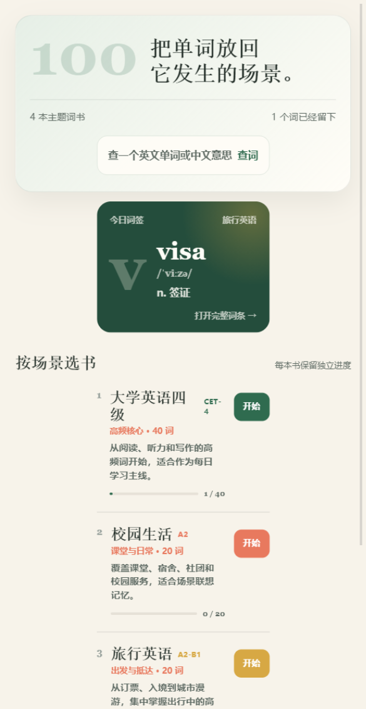
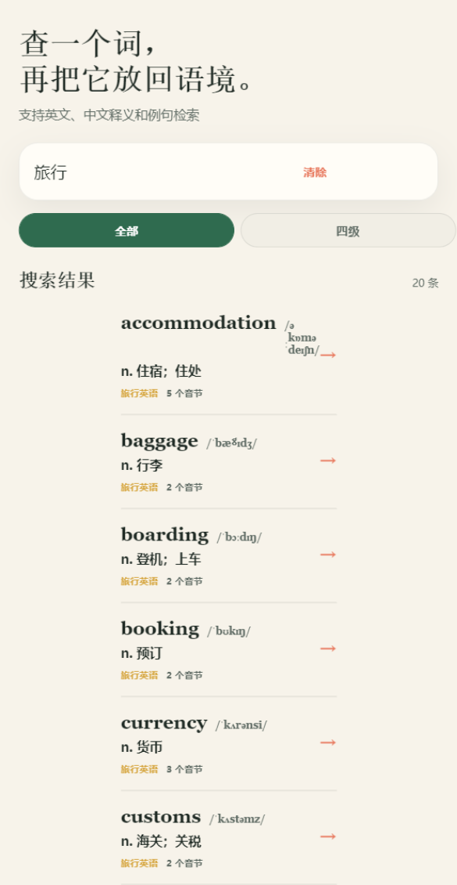
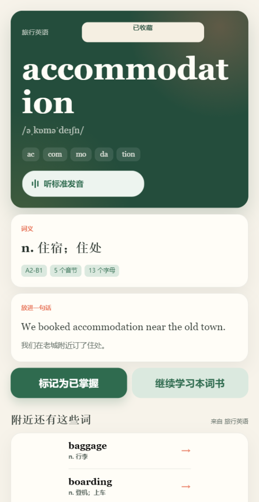
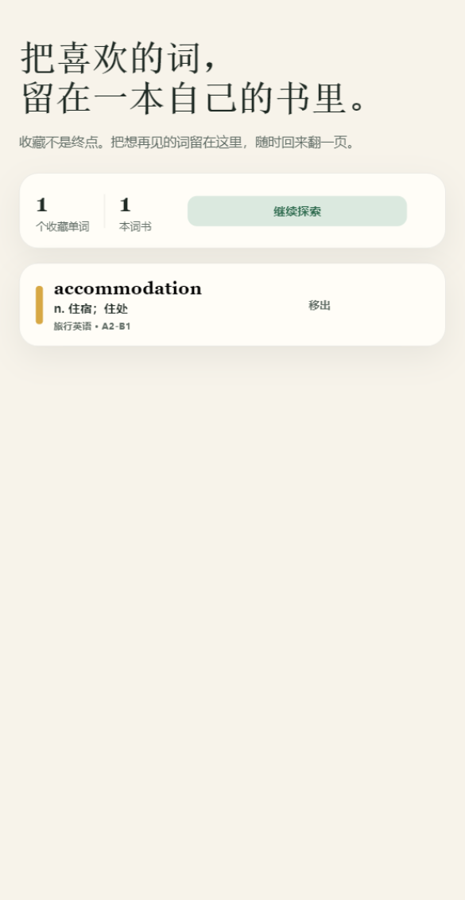
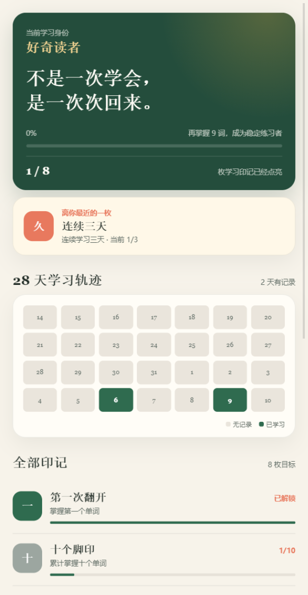
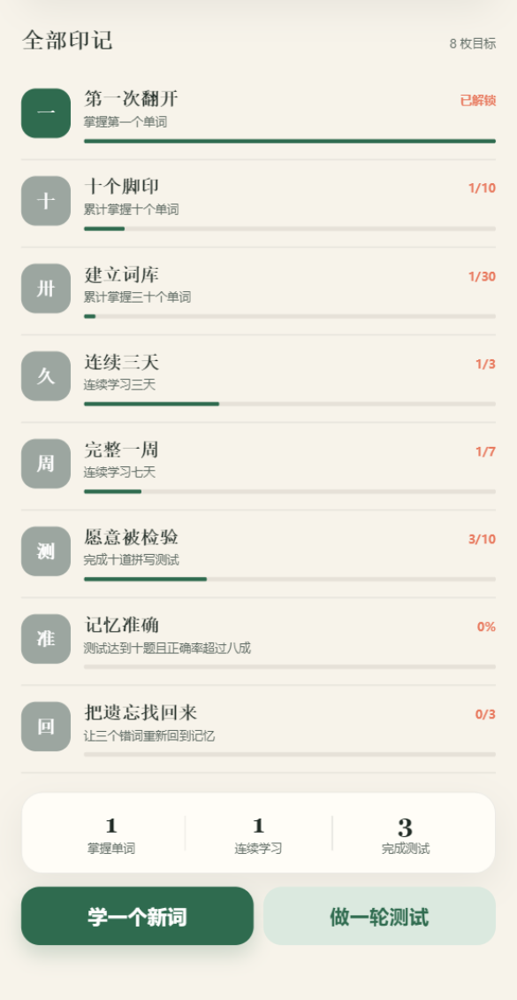
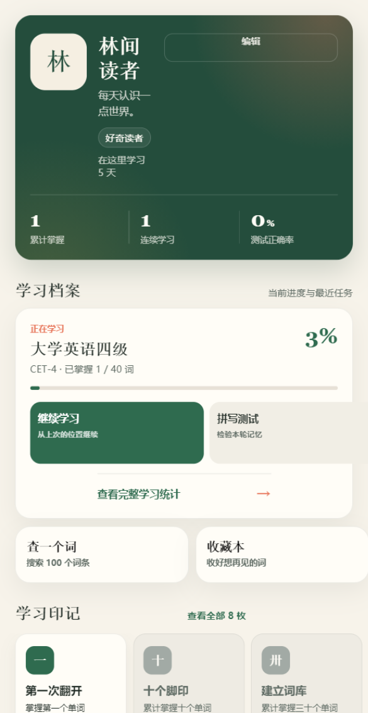
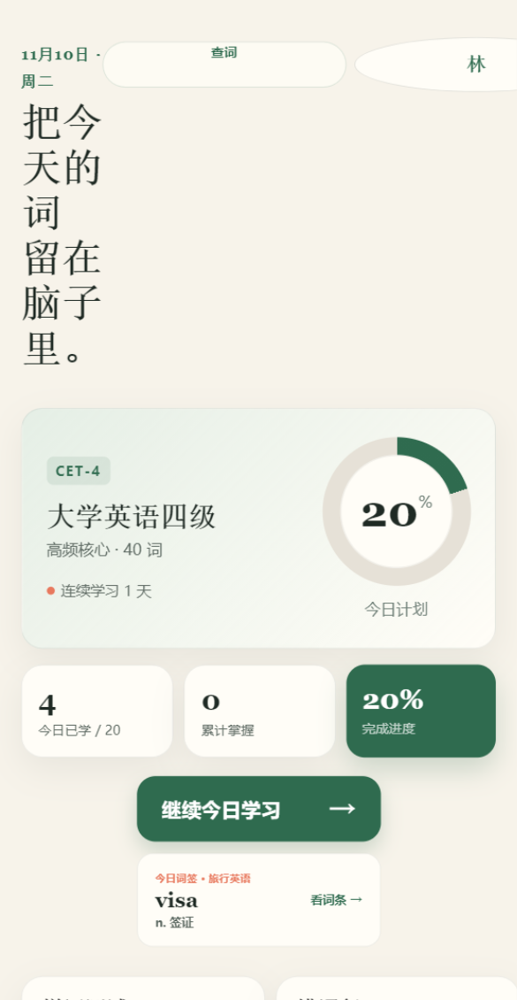

# Word Recite Mini Program

一个基于微信小程序与云开发的单词学习应用。项目提供今日计划、单词卡翻面、音节切分、TTS 发音、拼写测试、错词复习、学习统计与云端进度同步。

## 功能

- 内置 4 本主题词书、100 个带音标、音节、释义与双语例句的单词
- 首页展示今日学习目标、当前词书和完成进度
- 单独记录每天浏览过的单词，翻页、关闭和标记掌握都会计入今日学习
- 个人中心展示学习身份、连续学习、正确率、成就与词书进度
- 支持修改昵称和学习签名，并为不同词书分别保存进度
- 提供跨词书搜索、完整词条页和 28 天学习轨迹
- 支持收藏单词，并在独立收藏本中跨词书回看
- 成就墙包含学习等级、八项成就和最近四周活动日历
- 共 11 个页面，覆盖词书探索、双语检索、完整词条、收藏本、成就档案与个人中心
- 词条详情包含音标、音节拆读、双语例句、关联词和复习操作
- 单词卡支持翻面、音节切分、掌握状态切换
- 复用同一个 `InnerAudioContext` 播放 TTS，兼容 iOS 首次播放
- 拼写测试即时判分，错词自动进入复习队列
- 学习进度、测试结果与错词状态增量同步到云数据库
- 根据错词掌握程度计算下一次复习时间
- 统计连续打卡、正确率和累计学习量

## 页面预览

| 主题词书 | 跨词书搜索 |
| --- | --- |
|  |  |

| 单词详情 | 收藏本 |
| --- | --- |
|  |  |

| 学习成就 | 28 天轨迹 |
| --- | --- |
|  |  |

| 个人中心 | 今日学习 |
| --- | --- |
|  |  |

## 目录

```text
word-recite-miniprogram/
├─ miniprogram/          # 小程序端
├─ cloudfunctions/       # 微信云函数
├─ docs/                 # 数据库、接口与截图
├─ project.config.json
└─ README.md
```

## 本地运行

1. 在微信开发者工具中导入项目根目录。
2. 将 `project.config.json` 中的 `appid` 替换为自己的小程序 AppID。
3. 创建云开发环境并上传 `cloudfunctions` 下的五个云函数。
4. 在云数据库中创建 `users`、`wordbooks`、`words`、`progress`、`mistakes` 集合。
5. 本地词库位于 `miniprogram/data/seed`，云端不可用时仍可完成核心练习。

详细集合字段和云函数参数见 [数据库设计](docs/database.md) 与 [云函数 API](docs/api.md)。
完整页面职责与跳转关系见 [页面结构](docs/pages.md)。

## 提交记录

基础演示版保留了 13 个功能阶段节点；2026-11-09 新增主题词书扩充与个人学习中心。当前 Git 历史共 14 次提交，2026-11-10 的多页面与今日进度修复保留在工作区，尚未提交。

